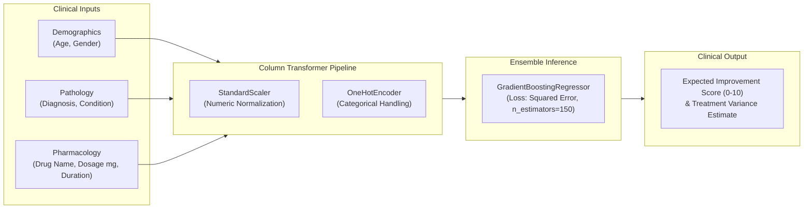

# 💊 Drug Effectiveness Predictor

> **Machine Learning Framework for Clinical Treatment Response & Efficacy Estimation**  
> Predicting therapeutic improvement scores and optimizing patient-specific treatment regimens using ensemble gradient boosting and multi-feature clinical trial data.

<p align="center">
  
  
  
  
</p>

---

## 🔬 Overview & Clinical Motivation

Clinical trial variance remains one of the largest bottlenecks in pharmacology. Patients with identical diagnoses frequently experience divergent therapeutic outcomes depending on age, biometric baselines, dosage schedules, and active compound interactions. 

**Drug Effectiveness Predictor** is an end-to-end clinical machine learning system that models non-linear interactions across patient demographics and pharmacokinetics. Built on a scikit-learn ensemble pipeline with automated column transformers, it provides quantitative therapeutic prognosis and an interactive Streamlit clinical decision support dashboard.

---

## ⚡ Architecture Pipeline



---

## 📊 Dataset Schema & Clinical Variables

The predictive pipeline is trained on multi-cohort trial data evaluating drug response trajectories:

| Feature Dimension | Data Type | Clinical Scope | Representation |
| :--- | :--- | :--- | :--- |
| `Patient_ID` | String | Unique Subject Identifier | Anonymized token (P0001...) |
| `Age` | Integer | Patient Chronological Age | 18 – 85 years |
| `Gender` | Categorical | Biological Sex | Male / Female |
| `Condition` | Categorical | Primary Medical Indication | Infection, Hypertension, Depression, Diabetes, etc. |
| `Drug_Name` | Categorical | Active Pharmaceutical Compound | Ciprofloxacin, Metoprolol, Bupropion, Metformin, etc. |
| `Dosage_mg` | Float | Prescribed Unit Dose | 25mg – 1000mg |
| `Treatment_Duration_days` | Integer | Course Duration | 5 – 90 days |
| `Side_Effects` | Categorical | Reported Adverse Events | Nausea, Tiredness, Dry mouth, Headache, None |
| **`Improvement_Score`** | **Float (Target)** | **Therapeutic Outcome Metric** | **0.0 (No recovery) to 10.0 (Full remission)** |

---

## 🛠️ Quickstart & Local Deployment

### 1. Clone & Setup Environment
```bash
git clone https://github.com/krishujeniya/drug-effectiveness-prediction.git
cd drug-effectiveness-prediction
python3 -m venv .venv
source .venv/bin/activate
pip install -r requirements.txt
```

### 2. Launch Interactive Clinical Dashboard
```bash
streamlit run app.py
```
Open your browser at `http://localhost:8501` to access the interactive dosage tuning and clinical prognosis dashboard.

### 3. Model Pipeline Script
```python
import pandas as pd
from sklearn.pipeline import Pipeline
from sklearn.compose import ColumnTransformer
from sklearn.preprocessing import StandardScaler, OneHotEncoder
from sklearn.ensemble import GradientBoostingRegressor

# Feature pipeline configuration
numeric_features = ["Age", "Dosage_mg", "Treatment_Duration_days"]
categorical_features = ["Gender", "Condition", "Drug_Name"]

preprocessor = ColumnTransformer([
    ("num", StandardScaler(), numeric_features),
    ("cat", OneHotEncoder(handle_unknown="ignore"), categorical_features)
])

model = Pipeline([
    ("preprocessor", preprocessor),
    ("regressor", GradientBoostingRegressor(n_estimators=150, max_depth=4, random_state=42))
])
```

---

## 📁 Repository Organization

```
├── app.py                                # Streamlit clinical dashboard & inference server
├── drug-effectiveness-prediction-s.ipynb  # Exploratory Data Analysis & hyperparameter search
├── real_drug_dataset.csv                 # Canonical clinical response dataset
├── requirements.txt                      # Pinned Python dependencies
└── LICENSE                               # MIT Open-Source License
```

---

## 📄 License & Academic Citation

This project is open-source under the [MIT License](LICENSE).

```bibtex
@software{ujeniya2026drugprediction,
  author = {Krish Ujeniya},
  title = {Drug Effectiveness Predictor: Clinical Treatment Response Regression Pipeline},
  year = {2026},
  publisher = {GitHub},
  url = {https://github.com/krishujeniya/drug-effectiveness-prediction}
}
```
