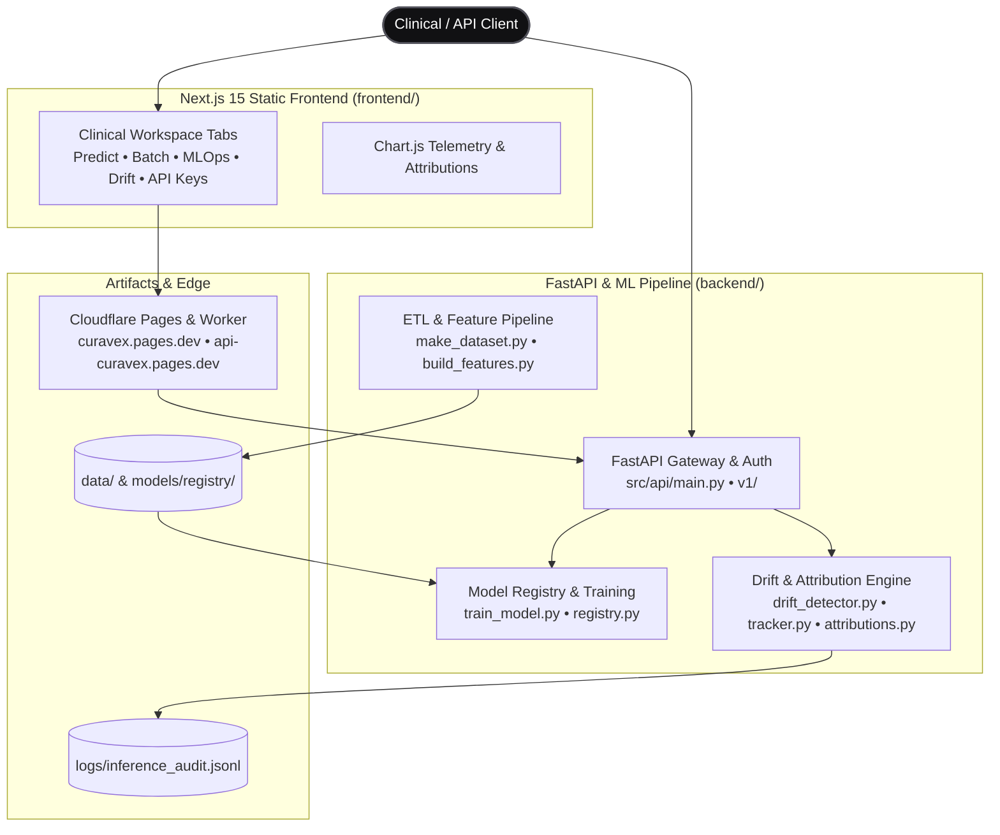

<p align="center">
  
</p>

<h1 align="center">Curavex</h1>

<p align="center">
  <strong>Clinical Treatment Response Regression and MLOps Platform</strong>
</p>

<p align="center">
  <a href="LICENSE"></a>
  <a href="https://curavex.pages.dev"></a>
  <a href="https://github.com/krishujeniya/curavex/actions/workflows/ci.yml"></a>
  <a href="https://github.com/krishujeniya"></a>
</p>

**Live Dashboard:** [curavex.pages.dev](https://curavex.pages.dev/) · **Backend API:** [api-curavex.pages.dev](https://api-curavex.pages.dev/) · **OpenAPI Docs:** [api-curavex.pages.dev/docs](https://api-curavex.pages.dev/docs) · **GitHub:** [krishujeniya/curavex](https://github.com/krishujeniya/curavex)

Curavex is a clinical treatment-response regression and MLOps governance platform created and maintained by [Krish Ujeniya (`@krishujeniya`)](https://github.com/krishujeniya). It predicts patient improvement scores from pharmacology parameters, scores multi-subject cohorts via CSV, and tracks model drift and inference latency.

The system combines a Next.js 15 App Router static frontend (`frontend/`) built with Tailwind CSS v4 and Wensity UI components, a FastAPI and scikit-learn backend (`backend/`), and Cloudflare edge deployment (`deploy/`, `wrangler.jsonc`).

---

## Architecture



---

## Core Components

| Component | Path | Responsibility |
|:---|:---|:---|
| **Next.js Frontend** | `frontend/src/` | Static App Router SPA with Wensity UI components, Tailwind CSS v4, and Chart.js visualizations |
| **FastAPI Gateway** | `backend/src/api/` | Versioned `/api/v1` REST endpoints, API key authentication, tiered rate limiting, and OpenAPI docs |
| **ML & ETL Pipeline** | `backend/src/data/`, `features/`, `models/` | Clinical bounds validation, `ColumnTransformer` preprocessing, training, and `.joblib` registry |
| **Observability** | `backend/src/monitoring/`, `explainability/` | Kolmogorov-Smirnov and PSI drift detection, latency percentiles, and feature impact attribution |
| **Deployment** | `deploy/`, `wrangler.jsonc` | Multi-stage Docker parity (`deploy/Dockerfile`) and Cloudflare Worker edge proxy (`deploy/edge/`) |
| **Tests & CI** | `backend/tests/`, `.github/workflows/ci.yml` | Automated pytest suite with an enforced >= 80% coverage ratchet |

---

## API Reference

All protected routes accept `X-API-Key` or `Authorization: Bearer <key>`. Interactive documentation is available at [api-curavex.pages.dev/docs](https://api-curavex.pages.dev/docs).

| Method | Endpoint | Description |
|:---|:---|:---|
| `POST` | `/api/v1/predict` | Single patient clinical response prognosis and feature attributions |
| `POST` | `/api/v1/predict/batch` | Batch JSON inference across multiple patient records |
| `POST` | `/api/v1/predict/upload-csv` | CSV file upload batch cohort scoring |
| `GET` | `/api/v1/models` | List registered model candidates and validation metrics |
| `POST` | `/api/v1/models/train` | Train and register a candidate regression model |
| `POST` | `/api/v1/models/{model_id}/promote` | Promote a candidate model to `PRODUCTION` |
| `GET` | `/api/v1/monitoring/drift` | Kolmogorov-Smirnov and PSI drift metrics |
| `GET` | `/api/v1/monitoring/metrics` | Latency percentiles (`avg`, `p50`, `p95`, `p99`), throughput, and error rate |
| `GET` | `/api/v1/monitoring/logs` | Recent inference audit trail |
| `GET` | `/api/v1/metadata/clinical` | Supported conditions, approved compounds, and dosing bounds |
| `GET` | `/healthz` | System health and active model probe |

---

## Local Quickstart

```bash
git clone https://github.com/krishujeniya/curavex.git && cd curavex

# Backend setup with uv
cd backend && uv sync && cd ..

# Frontend build (static export -> frontend/out/)
cd frontend && npm install && npm run build && cd ..

# Run ETL, train model, run tests, and start FastAPI on :8000
make data
make train
make test
make run
```

---

## Documentation

- [Architecture Overview](docs/index.md): Workspace structure and module responsibilities
- [Deployment Guide](docs/deployment.md): Cloudflare Pages, Cloudflare Workers, Docker parity, and rollback procedures
- [Data Dictionary](docs/references/data_dictionary.md): Clinical features, bounds, and target definitions

---

## License

This project is licensed under the MIT License. See [`LICENSE`](LICENSE) for details.
