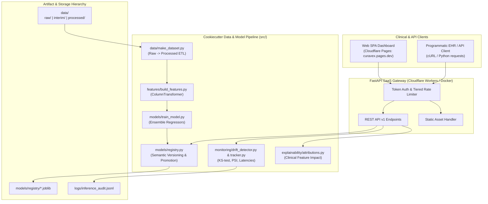

# Curavex | Clinical Treatment Response & MLOps Platform

<div align="center">
  
  <p><strong>Clinical Precision Oncology & Pharmacology Response Prediction</strong></p>
  <p>
    <a href="https://curavex.pages.dev"><strong>Live Frontend Dashboard</strong></a> &bull;
    <a href="https://api-curavex.pages.dev"><strong>Live Backend API</strong></a> &bull;
    <a href="https://api-curavex.pages.dev/docs"><strong>Interactive OpenAPI Docs</strong></a>
  </p>
</div>

[](https://github.com/krishujeniya/curavex/actions/workflows/ci.yml)
[](https://github.com/krishujeniya/curavex/actions/workflows/pages.yml)


[](https://curavex.pages.dev)
[](https://curavex.pages.dev)


---

## 1. System Architecture



---

## 2. Project Structure

```
curavex/
├── .editorconfig                  <- Editor formatting rules
├── .gitignore                     <- Build, env, and metadata guardrails
├── CHANGELOG.md                   <- Release notes
├── LICENSE                        <- Project license
├── Makefile                       <- Automation: make data, make train, make test, make run
├── README.md                      <- Top-level system overview
├── wrangler.jsonc                 <- Cloudflare Workers edge configuration
│
├── .github/workflows/
│   ├── ci.yml                     <- Backend ETL, pytest suite, and >= 80% coverage ratchet
│   └── cloudflare-deploy.yml      <- Cloudflare deployment workflow
│
├── backend/                       <- FastAPI service, ML pipeline, and tests
│   ├── .env.example               <- Backend environment template
│   ├── pyproject.toml             <- Python metadata, pytest, and coverage configuration
│   ├── requirements.txt           <- Pinned Python dependencies
│   ├── uv.lock                    <- uv lockfile
│   ├── main.py                    <- Compatibility entrypoint re-exporting src.api.main
│   ├── data/                      <- Data storage tiers (raw/, interim/, processed/, external/)
│   ├── models/registry/           <- Registered model artifacts (.joblib) and registry.json
│   ├── logs/                      <- Inference audit logs (.jsonl)
│   ├── src/                       <- Core Python package
│   │   ├── config.py              <- Central paths, feature definitions, and clinical bounds
│   │   ├── data/                  <- ETL and schema validation (make_dataset.py, validator.py)
│   │   ├── features/              <- ColumnTransformer feature pipeline (build_features.py)
│   │   ├── models/                <- Training, inference, and registry governance
│   │   ├── monitoring/            <- KS-test/PSI drift detection and telemetry tracker
│   │   ├── explainability/        <- Global and local clinical feature impact attribution
│   │   └── api/                   <- FastAPI app factory, auth, Pydantic v2 schemas, and v1 routers
│   └── tests/                     <- Automated pytest suite
│
├── frontend/                      <- Next.js 15 App Router static SPA (Tailwind CSS v4 + Wensity UI)
│   ├── .env.example               <- Frontend environment template
│   ├── next.config.ts             <- Static export configuration (output: "export" -> out/)
│   ├── package.json               <- Next.js, React 19, Chart.js, and Wensity dependencies
│   ├── tsconfig.json              <- TypeScript strict configuration
│   ├── public/                    <- Static assets (Curavex 2D B&W logos, CSV template, SEO files)
│   └── src/
│       ├── app/                   <- Root layout, global theme tokens, and workspace shell
│       ├── components/
│       │   ├── charts/            <- Chart.js wrappers (attribution, latency, drift)
│       │   ├── wensity/           <- Installed Wensity UI components
│       │   └── workspace/         <- Predict, Batch, MLOps, Monitoring, and API Keys tabs
│       └── lib/                   <- Typed FastAPI client and className utilities
│
├── deploy/                        <- Container and Cloudflare Worker configs
│   ├── Dockerfile                 <- Multi-stage container configuration
│   ├── docker-compose.yml         <- Local container parity composition
│   └── edge/                      <- Cloudflare Worker proxy and static metadata
│
└── docs/                          <- Documentation, data dictionary, and brand assets
    ├── index.md                   <- Architecture overview
    ├── deployment.md              <- Deployment and rollback runbook
    ├── references/                <- Data dictionary
    └── reports/                   <- Analysis figures and brand source assets
```

---

## 3. Makefile Automation Commands

| Command | Action |
| :--- | :--- |
| `make data` | Ingests `backend/data/raw/`, validates clinical constraints, and outputs `backend/data/processed/cleaned_drug_dataset.csv`. |
| `make train` | Trains baseline ensemble regressor on processed data and registers artifact into `backend/models/registry/`. |
| `make test` | Executes the automated test suite via `pytest` in `backend/`. |
| `make coverage` | Runs test suite and outputs coverage metrics (enforces >= 80% ratchet). |
| `make run` | Starts local FastAPI server and serves `frontend/out` on `http://localhost:8000`. |
| `make docker-build` | Builds production Docker container image from `deploy/Dockerfile`. |
| `make docker-run` | Runs containerized platform via `deploy/docker-compose.yml`. |
| `make clean` | Cleans temporary caches, bytecode, and test artifacts. |

---

## 4. API Reference

All requests accept `X-API-Key` or `Authorization: Bearer <key>`. Pre-seeded developer keys:
- Enterprise: `live_agyos_clinical_enterprise_key_99x` (1200 req/min)
- Standard: `live_agyos_standard_key_44b` (300 req/min)
- Guest Sandbox: `demo_key_public_guest` (60 req/min)

Live Interactive OpenAPI documentation is available at [https://api-curavex.pages.dev/docs](https://api-curavex.pages.dev/docs).

| Method | Endpoint | Description |
| :--- | :--- | :--- |
| `POST` | `/api/v1/predict` | Single patient clinical response prognosis |
| `POST` | `/api/v1/predict/batch` | High-throughput batch inference across multiple patient records |
| `POST` | `/api/v1/predict/upload-csv` | File-based CSV batch scoring |
| `GET` | `/api/v1/models` | List all registered model candidates and validation metrics |
| `POST` | `/api/v1/models/train` | Trigger retraining pipeline for an algorithm |
| `POST` | `/api/v1/models/{model_id}/promote` | Atomically promote model to `PRODUCTION` |
| `GET` | `/api/v1/monitoring/drift` | Statistical drift test results comparing live traffic to baseline |
| `GET` | `/api/v1/monitoring/metrics` | Operational telemetry (p50/p95/p99 latency, throughput, error rate) |
| `GET` | `/api/v1/monitoring/logs` | Queryable inference audit trail |
| `GET` | `/api/v1/metadata/clinical` | Supported conditions, approved drugs, dosage limits |
| `GET` | `/healthz` | System liveness probe |

---

## 5. Live Production Deployments

- **Frontend Dashboard (GitHub Pages)**: [https://curavex.pages.dev](https://curavex.pages.dev)
- **Backend API (Cloudflare Pages)**: [https://api-curavex.pages.dev](https://api-curavex.pages.dev)
- **API Documentation**: [https://api-curavex.pages.dev/docs](https://api-curavex.pages.dev/docs)
- **Health Check Probe**: [https://api-curavex.pages.dev/healthz](https://api-curavex.pages.dev/healthz)

---

## 6. Programmatic Integration Examples

### cURL

```bash
curl -X POST https://api-curavex.pages.dev/api/v1/predict \
  -H "Content-Type: application/json" \
  -H "X-API-Key: live_agyos_clinical_enterprise_key_99x" \
  -d '{
    "Age": 52,
    "Gender": "Male",
    "Condition": "Hypertension",
    "Drug_Name": "Amlodipine",
    "Dosage_mg": 250.0,
    "Treatment_Duration_days": 30
  }'
```

### Python Requests

```python
import requests

url = "https://api-curavex.pages.dev/api/v1/predict"
headers = {
    "Content-Type": "application/json",
    "X-API-Key": "live_agyos_clinical_enterprise_key_99x",
}
payload = {
    "Age": 52,
    "Gender": "Male",
    "Condition": "Hypertension",
    "Drug_Name": "Amlodipine",
    "Dosage_mg": 250.0,
    "Treatment_Duration_days": 30,
}

response = requests.post(url, headers=headers, json=payload)
data = response.json()

print(f"Predicted Score: {data['predicted_score']}")
print(f"Effectiveness Level: {data['effectiveness_level']}")
print(f"Confidence Interval: {data['confidence_interval']}")
```

---

## 7. Local Quickstart

```bash
# 1. Clone repository
git clone https://github.com/krishujeniya/curavex.git
cd curavex

# 2. Setup backend environment with uv
cd backend
uv sync
cd ..

# 3. Build Next.js frontend static export
cd frontend
npm install
npm run build
cd ..

# 4. Run ETL, train model, and verify tests
make data
make train
make test
make coverage

# 5. Launch local FastAPI server + Next.js static frontend
make run
```
