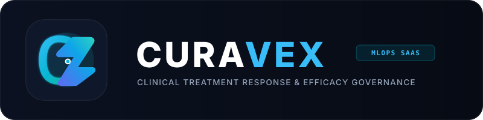
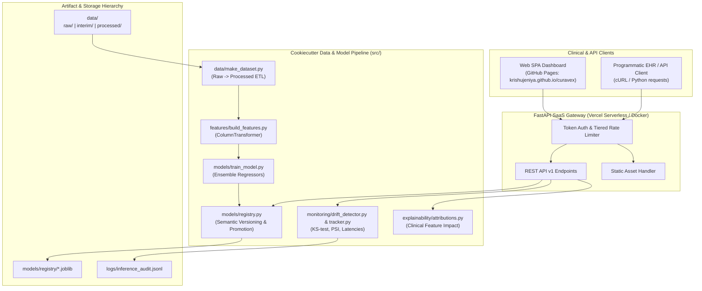

# Curavex | Clinical Treatment Response & MLOps Platform

<div align="center">
  
  <p><strong>Clinical Precision Oncology & Pharmacology Response Prediction</strong></p>
  <p>
    <a href="https://krishujeniya.github.io/curavex/"><strong>Live Frontend Dashboard</strong></a> &bull;
    <a href="https://curavex.vercel.app"><strong>Live Backend API</strong></a> &bull;
    <a href="https://curavex.vercel.app/docs"><strong>Interactive OpenAPI Docs</strong></a>
  </p>
</div>

[](https://github.com/krishujeniya/curavex/actions/workflows/ci.yml)
[](https://github.com/krishujeniya/curavex/actions/workflows/pages.yml)


---

## 1. System Architecture



---

## 2. Cookiecutter Project Structure

```
curavex/
├── Makefile                       <- Standard automation: make data, make train, make test, make run
├── README.md                      <- Top-level system overview
├── pyproject.toml                 <- Project metadata, pytest, and coverage configuration
├── requirements.txt               <- Pinned Python dependencies
├── vercel.json                    <- Serverless routing & CORS configuration
├── Dockerfile                     <- Multi-stage container configuration
├── docker-compose.yml             <- Production container service composition
│
├── .github/workflows/
│   ├── ci.yml                     <- Full pipeline validation, test suite, and 80% coverage ratchet
│   └── pages.yml                  <- Automated GitHub Pages continuous deployment for frontend
│
├── data/                          <- Data storage tiers
│   ├── raw/                       <- Immutable clinical dataset dump (real_drug_dataset.csv)
│   ├── interim/                   <- Intermediate transformed data
│   ├── processed/                 <- Canonical processed dataset (cleaned_drug_dataset.csv)
│   └── external/                  <- Third-party reference data
│
├── docs/                          <- Project documentation guides
├── notebooks/                     <- Ordered exploratory Jupyter notebooks
│   └── 1.0-eda-and-model-exploration.ipynb
│
├── models/                        <- Serialized models and governance metadata
│   └── registry/                  <- Registered model artifacts (.joblib) and registry.json
│
├── references/                    <- Data dictionaries and clinical indications
│   └── data_dictionary.md
│
├── reports/                       <- Generated analysis figures and evaluation metrics
│   ├── figures/
│   └── brand/                     <- Curavex logo design specifications
│
├── src/                           <- Core Python package
│   ├── __init__.py
│   ├── config.py                  <- Central paths, feature definitions, and clinical bounds
│   ├── data/                      <- Data processing and validation
│   │   ├── make_dataset.py        <- ETL script: raw -> processed
│   │   └── validator.py           <- Schema verification and clinical bounds checks
│   ├── features/                  <- Feature extraction and transformation
│   │   └── build_features.py      <- ColumnTransformer for numeric and categorical columns
│   ├── models/                    <- Model modeling and lifecycle
│   │   ├── train_model.py         <- Pipeline fitting, cross-validation, and benchmarks
│   │   ├── predict_model.py       <- Single/batch inference runners and confidence intervals
│   │   └── registry.py            <- Semantic versioning, stage transitions, and persistence
│   ├── monitoring/                <- Observability and telemetry
│   │   ├── drift_detector.py      <- Kolmogorov-Smirnov test and categorical PSI
│   │   └── tracker.py             <- Inference logger, latency percentiles, and metrics
│   ├── explainability/            <- Interpretability
│   │   └── attributions.py        <- Global and local clinical feature impact attribution
│   └── api/                       <- FastAPI REST serving and web dashboard
│       ├── main.py                <- Application factory, CORS, static file mounts
│       ├── config.py              <- API settings and rate tier definitions
│       ├── security/auth.py       <- API Key authentication and rate limiting
│       ├── schemas/               <- Pydantic v2 schemas
│       └── v1/                    <- REST API routers (predict, models, monitoring, metadata, api_keys)
│
├── frontend/                      <- Modern clinical web dashboard
│   ├── index.html                 <- Emil Kowalski compliant responsive interface
│   ├── css/app.css                <- Concentric radii rules and dark obsidian theme
│   ├── js/app.js                  <- Reactive client controller with auto-detected backend
│   ├── js/charts.js               <- Chart.js renderers (drift, latency, feature attribution)
│   ├── assets/                    <- Curavex SVG and PNG vector logos & marks
│   └── demo_batch_cohort.csv      <- Sample clinical cohort dataset
│
├── tests/                         <- Automated test suite (>86% code coverage)
└── logs/                          <- Persistent inference audit logs (.jsonl)
```

---

## 3. Makefile Automation Commands

| Command | Action |
| :--- | :--- |
| `make data` | Ingests `data/raw/` dataset, validates clinical constraints, and outputs `data/processed/cleaned_drug_dataset.csv`. |
| `make train` | Trains baseline ensemble regressor on processed data and registers artifact into `models/registry/`. |
| `make test` | Executes all 30 automated tests via `pytest`. |
| `make coverage` | Runs test suite and outputs coverage metrics (enforces $\ge 80\%$ ratchet). |
| `make run` | Starts local FastAPI server and dashboard on `http://localhost:8000`. |
| `make docker-build` | Builds production Docker container image. |
| `make docker-run` | Runs containerized platform via `docker-compose`. |
| `make clean` | Cleans temporary caches, bytecode, and test artifacts. |

---

## 4. API Reference

All requests accept `X-API-Key` or `Authorization: Bearer <key>`. Pre-seeded developer keys:
- Enterprise: `live_agyos_clinical_enterprise_key_99x` (1200 req/min)
- Standard: `live_agyos_standard_key_44b` (300 req/min)
- Guest Sandbox: `demo_key_public_guest` (60 req/min)

Live Interactive OpenAPI documentation is available at [https://curavex.vercel.app/docs](https://curavex.vercel.app/docs).

| Method | Endpoint | Description |
| :--- | :--- | :--- |
| `POST` | `/api/v1/predict` | Single patient clinical response prognosis |
| `POST` | `/api/v1/predict/batch` | High-throughput batch inference across multiple patient records |
| `POST` | `/api/v1/predict/upload-csv` | File-based CSV batch scoring |
| `GET` | `/api/v1/models` | List all registered model candidates and validation metrics |
| `POST` | `/api/v1/models/train` | Trigger retraining pipeline for an algorithm |
| `POST` | `/api/v1/models/{model_id}/promote` | Atomically promote model to `PRODUCTION` |
| `GET` | `/api/v1/monitoring/drift` | Statistical drift test results comparing live traffic to baseline |
| `GET` | `/api/v1/monitoring/metrics` | Operational telemetry (p50/p95/p99 latency, throughput, error rate) |
| `GET` | `/api/v1/monitoring/logs` | Queryable inference audit trail |
| `GET` | `/api/v1/metadata/clinical` | Supported conditions, approved drugs, dosage limits |
| `GET` | `/healthz` | System liveness probe |

---

## 5. Live Production Deployments

- **Frontend Dashboard (GitHub Pages)**: [https://krishujeniya.github.io/curavex/](https://krishujeniya.github.io/curavex/)
- **Backend API (Vercel Serverless)**: [https://curavex.vercel.app](https://curavex.vercel.app)
- **API Documentation**: [https://curavex.vercel.app/docs](https://curavex.vercel.app/docs)
- **Health Check Probe**: [https://curavex.vercel.app/healthz](https://curavex.vercel.app/healthz)

---

## 6. Programmatic Integration Examples

### cURL

```bash
curl -X POST https://curavex.vercel.app/api/v1/predict \
  -H "Content-Type: application/json" \
  -H "X-API-Key: live_agyos_clinical_enterprise_key_99x" \
  -d '{
    "Age": 52,
    "Gender": "Male",
    "Condition": "Hypertension",
    "Drug_Name": "Amlodipine",
    "Dosage_mg": 250.0,
    "Treatment_Duration_days": 30
  }'
```

### Python Requests

```python
import requests

url = "https://curavex.vercel.app/api/v1/predict"
headers = {
    "Content-Type": "application/json",
    "X-API-Key": "live_agyos_clinical_enterprise_key_99x",
}
payload = {
    "Age": 52,
    "Gender": "Male",
    "Condition": "Hypertension",
    "Drug_Name": "Amlodipine",
    "Dosage_mg": 250.0,
    "Treatment_Duration_days": 30,
}

response = requests.post(url, headers=headers, json=payload)
data = response.json()

print(f"Predicted Score: {data['predicted_score']}")
print(f"Effectiveness Level: {data['effectiveness_level']}")
print(f"Confidence Interval: {data['confidence_interval']}")
```

---

## 7. Local Quickstart

```bash
# 1. Clone repository
git clone https://github.com/krishujeniya/curavex.git
cd curavex

# 2. Setup virtual environment
python3 -m venv .venv
source .venv/bin/activate
pip install -r requirements.txt
pip install -e .

# 3. Run ETL and train model
make data
make train

# 4. Verify test suite & coverage
make test
make coverage

# 5. Launch local server
make run
```
